# Вектор — презентация проекта

**Киберрывок · Осень 2026**

Семантический поиск по видеолекциям: от файла до нужной секунды.

- [Скачать презентацию (PPTX)](Вектор_презентация.pptx) — 14 слайдов, 16:9, со скриншотами и заметками докладчика.
- [Вернуться к README](../README.md)
- [Отчёт о тестировании](../TESTS.md)

Все изображения лежат в [`screenshots/`](screenshots/) и используются и в PPTX,
и в этом документе. Скриншоты интерфейса сняты в реальном запущенном приложении:
1440 × 900 для десктопа и 780 × 1688 (390 × 844 CSS px при DPR 2) для мобильного.

**План показа на 7 минут:** проблема и решение — 1 мин · интерфейс и плеер — 2 мин ·
поиск, Q&A и конспект — 2 мин · архитектура, тесты и диагностика — 1 мин ·
мобильная версия и итоги — 1 мин.

---

## Слайд 1. Вектор

**Найдите момент, а не таймкод.**

Семантический поиск по видеолекциям: загрузка, расшифровка, конспект, структура
и переход к нужной секунде по смыслу запроса.

`FastAPI` · `faster-whisper` · `potion-multilingual` · `SQLite`

Полностью локальный прототип, без обязательных API-ключей, запуск одной командой.

> **Заметки докладчика.** «Вектор» — прототип семантического поиска по
> видеолекциям. Главная идея: пользователь ищет смысл, а не точные слова,
> и сразу попадает на нужную секунду.

---

## Слайд 2. Проблема

**Лекция длится час. Нужная мысль — 40 секунд.**

Искать по таймкоду, субтитрам и названиям глав долго. Конспект приходится
писать вручную.

| Метрика | Значение | Комментарий |
|---|---|---|
| 90+ минут | средняя видеолекция | |
| ~15 минут | на ручной поиск фрагмента | |
| 0 систем | ищут по смыслу, а не по словам | |

**Что не работает сегодня**

- **Поиск по словам.** «Как учится нейросеть» не находит «сеть учится на данных».
- **Ручная навигация.** Студент перематывает видео, чтобы проверить одну цитату.
- **Нет структуры.** Конспект, главы и термины приходится собирать вручную.

> **Заметки докладчика.** Боль: видеолекции длинные, а поиск обычно лексический.
> Нужен инструмент, который понимает смысл и сразу ведёт к моменту.

---

## Слайд 3. Решение

**Один путь: от файла до нужной секунды**

Четыре шага, без ручной разметки, субтитров и облачных сервисов.

1. **Загрузка.** MP4, WebM, MOV или ссылка YouTube / Vimeo. Файл остаётся на вашем сервере.
2. **Расшифровка.** Whisper распознаёт речь, расставляет таймкоды и слова. Язык — автоматически.
3. **Индексация.** model2vec считает векторы реплик. TextRank собирает конспект, главы и термины.
4. **Поиск.** Запрос на естественном языке → фрагмент, таймкод и переход в плеере.

**Результат:** студент задаёт вопрос по-человечески и оказывается на нужной
секунде за один клик.

> **Заметки докладчика.** Вся цепочка автоматическая: загрузка, ASR, эмбеддинги,
> структура, поиск. Ключевой результат — переход к моменту, а не список файлов.

---

## Слайд 4. Библиотека и живой поиск

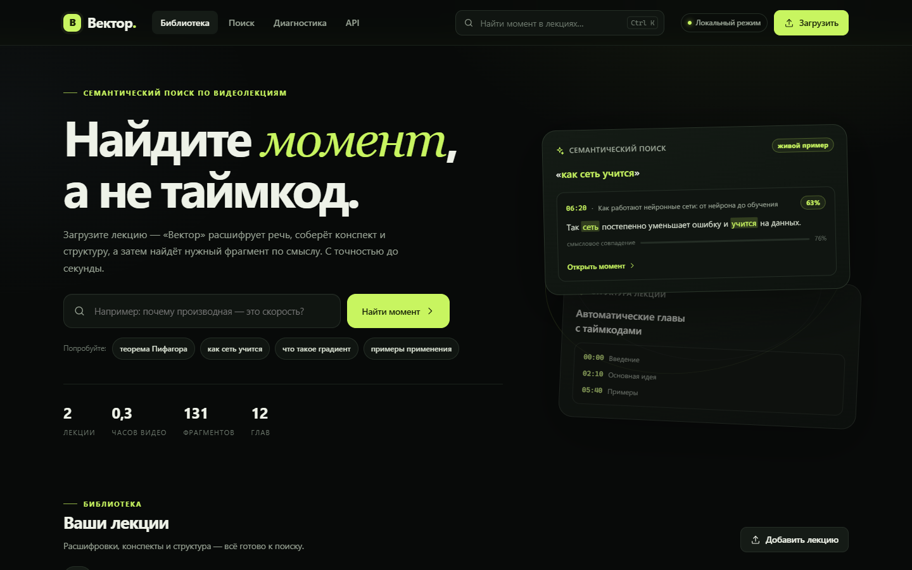

**Что на экране**

- 2 демо-лекции, 131 фрагмент, 12 глав;
- поиск по всему курсу из шапки;
- загрузка и импорт по ссылке;
- редакторский тёмный интерфейс без сборки.

«Откройте момент» — каждая карточка результата ведёт на таймкод.

> **Заметки докладчика.** Главная страница показывает ценность сразу: живой
> семантический пример, статистику и библиотеку.

---

## Слайд 5. Загрузка

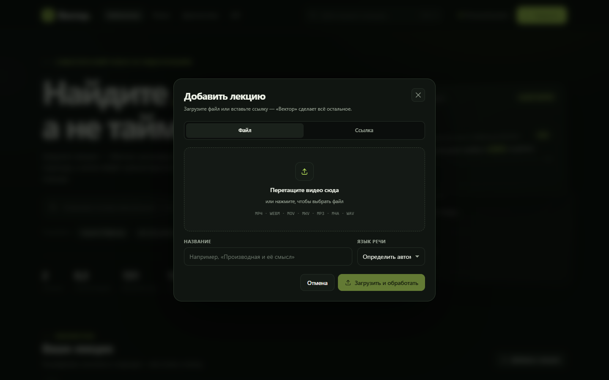

**Файл или ссылка — дальше без ручной работы**

Очередь, прогресс и статусы: «В очереди → Обработка → Готово».

**Поддерживается**

- **Видео:** MP4, WebM, MOV, MKV, M4V, AVI.
- **Аудио:** MP3, M4A, WAV, OGG, OPUS.
- **Ссылки:** YouTube и Vimeo через `yt-dlp`.
- **Проверка:** ffprobe, длительность, кодек, превью.
- **Хранение:** файлы вне БД, отдача с HTTP Range.

> **Заметки докладчика.** Загрузка поддерживает видео, аудио и ссылки.
> Валидация и превью — на стороне сервера. Файлы лежат вне SQLite, видео
> отдаётся с поддержкой Range.

---

## Слайд 6. Плеер, который понимает текст

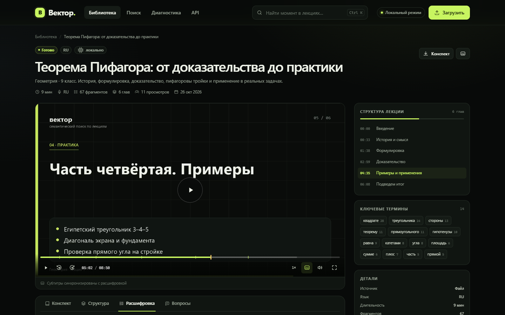

**Навигация**

- клик по реплике перематывает видео;
- активная реплика подсвечивается;
- субтитры VTT поверх видео;
- маркеры глав и результатов на таймлайне;
- deep link `?t=302` и «поделиться моментом».

Скорость, звук, ±10 секунд, fullscreen — без внешнего плеера.

> **Заметки докладчика.** Собственный плеер: клик по тексту перематывает,
> активная реплика подсвечивается. Ссылка `?t=302` открывает лекцию ровно
> на нужном моменте.

---

## Слайд 7. Конспект и структура

**Лекция сама становится оглавлением**

Экстрактивный конспект, ключевые тезисы с таймкодами и автоматические главы.

| Конспект | Главы |
|---|---|
| 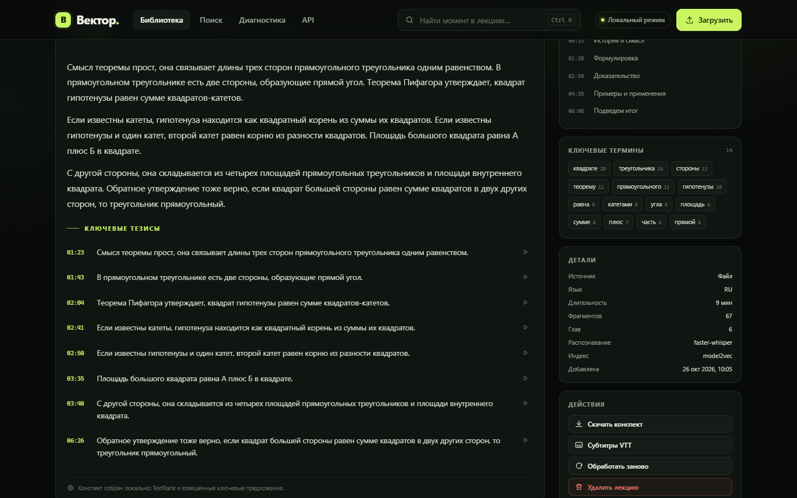 | 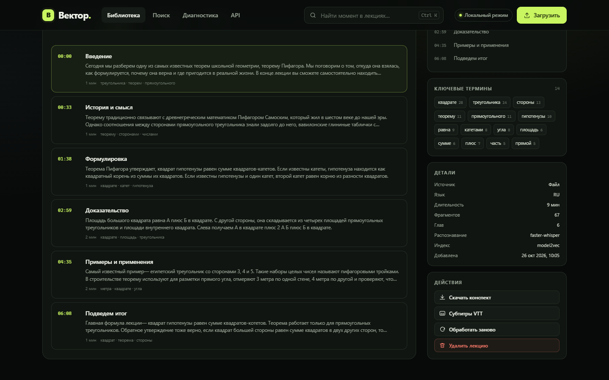 |
| Главная мысль и ключевые тезисы с таймкодами | Главы, названия и переходы к началу |

TextRank + семантические сдвиги: без ручной разметки и без обязательного LLM.
Экспорт конспекта — в Markdown, субтитры — в VTT/SRT.

> **Заметки докладчика.** Конспект и главы строятся локально. На слайде — один
> и тот же экран в двух вкладках. Всё можно скачать: Markdown, VTT, SRT.

---

## Слайд 8. Семантический поиск

**Находит смысл, даже когда слов нет**

Гибрид dense + BM25 + покрытие запроса + MMR-диверсификация.

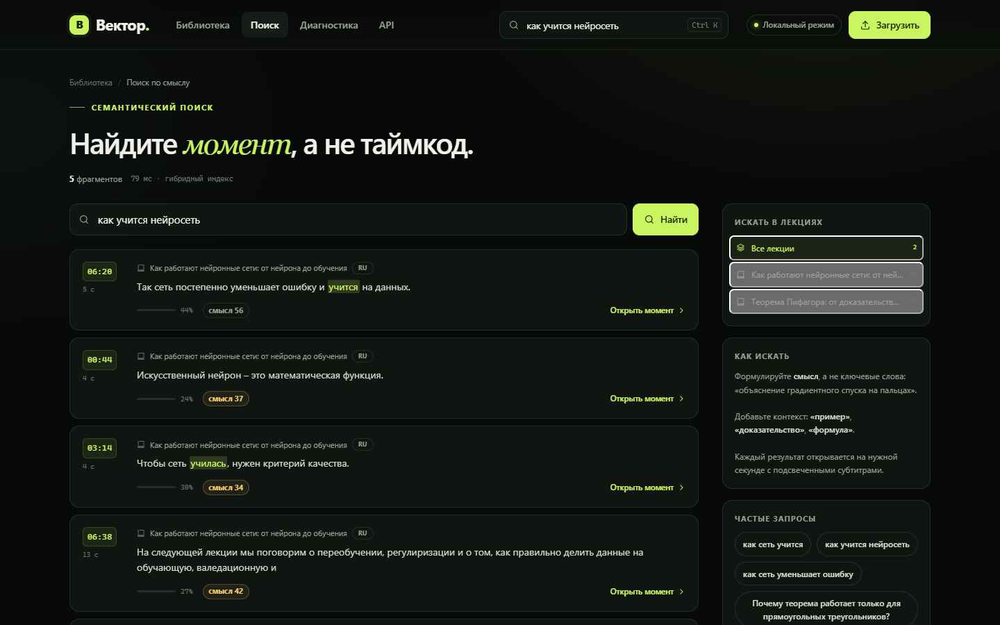

**Запрос:** «как учится нейросеть»
**Найдено на 06:20:** «Так сеть постепенно уменьшает ошибку и учится на данных»

- слова «нейросеть» в тексте нет;
- каждый результат — таймкод и сниппет;
- фильтр по лекции или весь курс.

> **Заметки докладчика.** Главный вау-момент: запрос «как учится нейросеть»
> находит фразу «сеть учится на данных». Слова «нейросеть» в тексте нет —
> работает смысловой индекс.

---

## Слайд 9. Вопрос-ответ

**Ответ с цитатами, а не пересказ без источника**

RAG по расшифровке: офлайн-экстрактивный режим или любой
OpenAI-совместимый LLM.

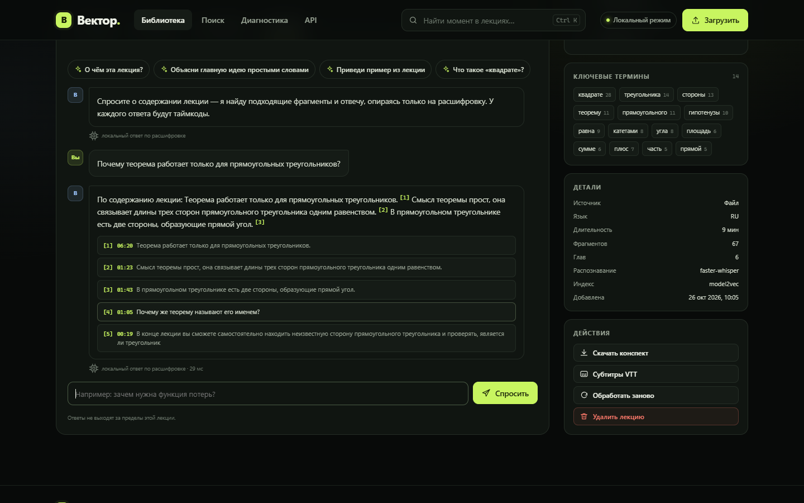

**Как это работает**

- вопрос → поиск релевантных реплик;
- ответ только по расшифровке лекции;
- у каждой мысли — номер и таймкод;
- без LLM — экстрактивный режим;
- с LLM — формулировки, но те же цитаты.

Ответ не выходит за пределы лекции: меньше галлюцинаций и понятная проверка.

> **Заметки докладчика.** Q&A отвечает по расшифровке и даёт цитаты. Без LLM
> это экстрактивный ответ, с LLM — более гладкий текст, но опора всё равно
> на найденные фрагменты.

---

## Слайд 10. Архитектура

**Всё локально, без облака**

SPA без сборки, FastAPI, SQLite WAL, файловое хранилище и одна очередь обработки.

```text
Браузер · SPA на ES-модулях · History API · Range и VTT
                          ↓
FastAPI · API, безопасные заголовки, gzip, стриминг, SPA fallback
        ↓                       ↓                       ↓
   Хранилище               Обработка             Поиск и ответы
   SQLite WAL              ffmpeg / ffprobe      dense + BM25
   медиа и аудио           faster-whisper        MMR-диверсификация
   float32-векторы         model2vec             RAG с цитатами
   кэш индекса             TextRank / главы      VTT / SRT / Markdown
```

Модели: `faster-whisper-small` + `potion-multilingual-128M`. После первой
загрузки интернет не нужен.

> **Заметки докладчика.** Архитектура намеренно простая: один процесс FastAPI,
> SQLite и файловое хранилище. Очередь обработки — ThreadPool с прогрессом в БД.
> Всё работает офлайн.

---

## Слайд 11. Качество подтверждено тестами

**157 тестов:** unit, API, пайплайн и реальная загрузка до статуса `ready`.

| Метрика | Значение | Комментарий |
|---|---|---|
| **156** | passed | зелёный прогон pytest |
| **1** | skipped | только реальный Whisper smoke |
| **9,9** | секунды | полный быстрый прогон |
| **0** | ошибок JS | в консоли UI |

**Что покрыто**

- текст, леммы, TextRank, главы, VTT/SRT;
- все HTTP-методы и коды ошибок;
- гибридный поиск, MMR, сниппеты;
- пайплайн с моками и E2E-загрузка;
- ASR-обёртка, эмбеддинги, Q&A.

**Найденные и исправленные баги**

- кириллица в `Content-Disposition` экспорта;
- ложные «висячие союзы» на «и»;
- пробелы перед пунктуацией в ASR;
- подсветка словоформ в сниппетах;
- горизонтальный скролл на мобильном поиске.

```text
python -m pytest -q  →  156 passed, 1 skipped in 9.94s
```

> **Заметки докладчика.** Тесты нашли четыре реальных дефекта — все исправлены.
> Пятый, горизонтальный скролл на мобильном поиске, обнаружился при ручной
> проверке вёрстки. Один skipped — дымовой тест настоящего Whisper, включается
> переменной `VECTOR_SLOW_TESTS=1`.

---

## Слайд 12. Диагностика

**Видно, что работает, а что требует внимания**

Health-check БД, ffmpeg, ASR, эмбеддингов, LLM и очереди — на одном экране.

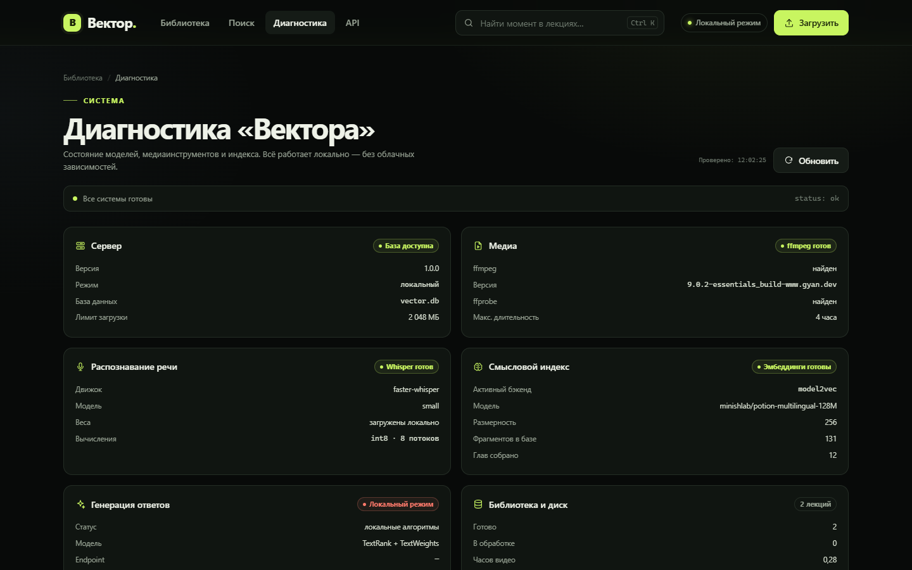

**Почему это важно**

- видно, скачаны ли модели;
- видно, найден ли ffmpeg;
- прогресс очереди и активные задачи;
- предупреждения с человеческим текстом;
- статистика: часы, фрагменты, запросы.

Офлайн-режим: после первой загрузки моделей сеть не требуется.

> **Заметки докладчика.** Диагностика снимает страх «а оно точно работает?».
> Видно состояние моделей, ffmpeg и очереди.

---

## Слайд 13. Мобильная вёрстка

**Тот же поиск — в кармане**

Отдельные раскладки для 390 px: библиотека, лекция и результаты без
горизонтального скролла.

| Библиотека | Лекция | Поиск |
|---|---|---|
| 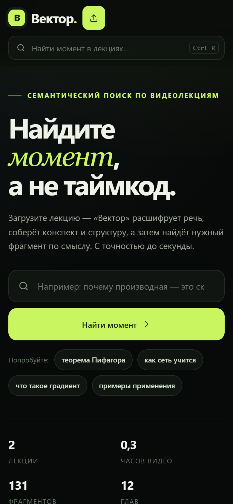 | 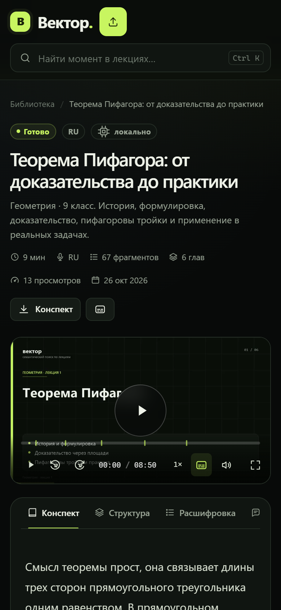 | 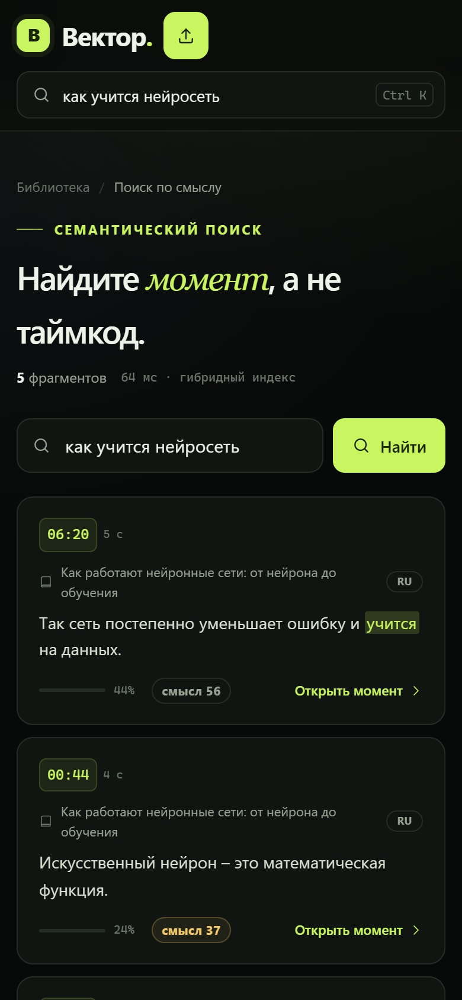 |

**Проверено**

- 390 × 844, без горизонтального скролла;
- плеер и расшифровка перестраиваются;
- фильтры и результаты читаемы;
- меню и поиск доступны с телефона.

Мобильный поиск был с горизонтальным скроллом. Исправлено: `minmax(0, 1fr)`
и `min-width: 0` в гридах.

> **Заметки докладчика.** Мобильная проверка выявила горизонтальный скролл
> на странице поиска. Исправлено в CSS. Сейчас 390 px: библиотека, лекция
> и поиск без переполнения.

---

## Слайд 14. Что уже работает

- Загрузка MP4 / WebM и ссылок → `ready` без ручных действий.
- Транскрипт с таймкодами, клик по реплике перематывает.
- Семантический поиск находит фрагмент без точных слов.
- Конспект, главы и термины появляются автоматически.
- Поиск по двум лекциям, Q&A с цитатами, экспорт.

**Запуск одной командой**

```powershell
.\run.ps1
```

```bash
./run.sh
```

`venv → зависимости → ffmpeg → модели → демо → сервер`

**Дальше**

- GPU-ASR и несколько воркеров;
- авторизация и курсы;
- аналитика по вопросам студентов;
- экспорт в LMS.

Вектор — не ещё один видеоплеер. Это слой понимания, который превращает
часовую запись в управляемый конспект и точку входа в нужный момент.

> **Заметки докладчика.** Итог: все пункты приёмки закрыты. Запуск одной
> командой, полностью локально. Дальше — GPU, многопользовательский режим
> и интеграция с LMS.

---

## Как воспроизвести скриншоты

1. Запустите приложение: `.\run.ps1 -Fast` (демо-лекции уже в репозитории).
2. Откройте <http://127.0.0.1:8000>.
3. Для десктопа задайте окно 1440 × 900, для мобильного — 390 × 844 CSS px.
4. Снимайте экраны из `screenshots/` в том же порядке: главная, библиотека,
   лекция на 05:02, конспект, главы, расшифровка, поиск, Q&A, загрузка,
   диагностика, мобильные страницы.

Актуальные скриншоты: [docs/screenshots](screenshots/).
